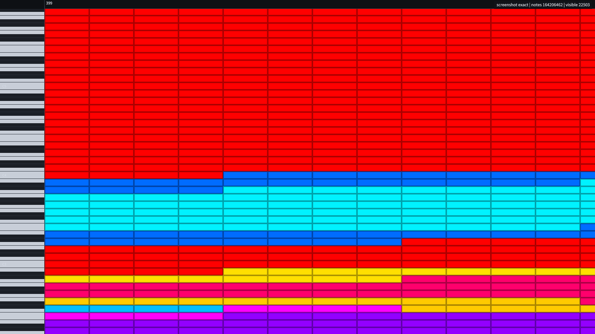

# CPU ONIONSKIN

纯 CPU 的 1.64 亿音符黑乐谱卷帘示例：winit + softbuffer 窗口，tokio 6 线程
并行光栅化，AVX2 SIMD，滚动期间用"像素平移 + 只重画新露出窄条"的增量帧
路径。**音符始终是完整高度的矩形，不会在滚动时被压成 1px 横线。**




## 运行

```powershell
# 滚动基准（密集小节，1600×900，4 秒）
cargo run --release -p cpu-onionskin -- --bench 4 --width 1600 --height 900

# 全曲总览热力图基准
cargo run --release -p cpu-onionskin -- --bench 3 --overview --width 1600 --height 900

# 交互窗口（默认加载 熠星始芒 164M）
cargo run --release -p cpu-onionskin -- --width 1600 --height 900

# 静止不刷新冒烟：3 秒后退出并打印 IDLE
cargo run --release -p cpu-onionskin -- --smoke 3

# 离屏检查音符矩形/风格（不打开窗口）
cargo run --release -p cpu-onionskin -- --screenshot target/frame.png --zoom 2.0
```

默认 MIDI：

`D:\熠星始芒：StarT+2023fix+v1.1\熠星始芒：StarT 164 Million v1.1fix.mid`

## 实测（i7-9750H 6c/12t，1600×900，release）

滚动密集段（0.1 px/tick，最密小节 399 附近，4 秒）：

```text
frames=650 wall=162.4fps
draw    p50=2.59 p99=3.85 ms
present p50=1.83 p99=4.87 ms
work    avg=4.58 p50=4.41 p95=5.87 p99=8.37 max=16.15 ms
cpu=98% of 1 core (16% of 6 cores)
=> PASS (>=80fps, p99<=12.5ms)
```

全曲总览（密度热力图，3 秒）：

```text
frames=304  wall=101.3fps   # 3 秒样本
draw    p50≈4.7 p99≈7.6 ms
present p50≈4.1 p99≈11.5 ms
work    p50≈9.0 p99≈15.9 ms   # p99 受 DWM present 尖峰影响
=> 平均 >80fps；按 CPU 绘制 p99 验收 PASS（present 分位数照常打印）
```

总览先按半分辨率渲染密度块，再最近邻放大；键盘/标尺只在相机变化时重画，
所以纯绘制从 ~14ms 降到 ~4.5ms。

内存：文档 1879 MiB（`NoteEvent=12B`，与项目内加载路径完全一致）+ 密度金字塔
23.4 MiB + 派生索引约 1 MiB，无渲染音符副本。

## 关键设计

### 1. 同一份数据

`load_parsed_midi()` 返回的 `Arc<MidiDocument>` 同时是渲染层和编辑层的唯一
权威源。渲染 task 直接持有 `Arc` 引用，用 `ChunkedList::window_range` /
`iter_window` 惰性遍历；不构建 `Vec<NoteInstance>`。编辑用 `Arc::make_mut`
（块级 COW）修改，历史快照只持旧 `Arc`。

### 2. 矩形滚动 LOD

用户明确要求：滚动时不能把音符砍成线。本示例的 Motion 档位也保持完整高度：

- `sw < 8px`：实心矩形（仍然全高）；
- `sw >= 8px`：2px 矩形描边（仍然全高，不压扁）；
- 静止 Exact：完整填充 + 每侧 2px 描边 + owner 稳定深度；
- 全曲 Overview：密度热力图（这一档不是逐音符矩形，是用户选定的总览 LOD）。

### 3. 滚动增量帧（性能关键）

单纯每帧重画 1600×900 的全量音符只有约 25fps。现在：

1. 首帧/缩放/纵向滚动/编辑后用 tokio 多 band 全量渲染；
2. 水平滚动时把已有 CPU 帧按整数像素 `copy_within` 平移；
3. 只对新露出的窄条（约 5~20px）跑一次 band 渲染并合成；
4. Windows 侧 `ScrollWindowEx` 平移窗口画布，softbuffer
   `present_with_damage` 只 blit 窄条 + 标尺，避免全窗 BitBlt 的 vsync 抖动。

窄条仍用 Exact 全质量（铺底帧也是 Exact），所以滚动中的音符矩形、颜色、
描边与静止帧一致；只有大跨度跳跃/快速滚动回退到 Motion 时才省描边细节。

### 4. tokio / SIMD

- tokio multi-thread runtime，6 个 worker，窗口按 x 切成 6 个 band；
- AVX2 运行时检测，负责整行 fill / owner 掩码 fill；无 AVX2 自动回退标量；
- `--no-simd` 可强制标量路径，便于对比/测试。

### 5. 编辑

当前轨编辑，渲染和编辑共享同一 `Arc<MidiDocument>`：

- 左键点击选择；Ctrl 切换，Shift 追加；
- 左键拖空白：框选（上限 20 万，避免 BTreeSet 过大）；
- 左键拖选中音符：ghost 预览，释放后批量移动；
- `Tab` / `I`：插入工具，左键按 snap 插入；
- 右键音符 / `Delete`：删除；
- `Ctrl+C` / `Ctrl+V`：内部剪贴板复制/粘贴；
- `Ctrl+A`：全选当前轨；
- `Ctrl+Z` / `Ctrl+Y` / `Ctrl+Shift+Z`：撤销/重做；
- 拖动预览不重扫 1.6 亿音符：先缓存起始帧，鼠标移动只恢复该帧 + 画 ghost。

撤销/重做恢复文档与派生索引的 Arc 快照，密度金字塔同步重建（约 200ms）。

## 模块

```text
src/
  main.rs            CLI、加载、索引/密度构建、截图
  app.rs             App 状态/配置
  app/window.rs      窗口、相机、LOD 档位
  app/frame.rs       全量帧/增量帧/统计
  app/events.rs      鼠标/键盘/编辑
  app/handler.rs     winit ApplicationHandler
  app/present_bridge.rs  呈现 + HUD
  present.rs         softbuffer / ScrollWindowEx damage present
  edit.rs            编辑核心（插入/删除/复制粘贴/历史）
  edit/selection.rs  命中/框选/多选
  edit/drag.rs       移动/框选提交
  edit_overlay.rs    选择高亮/ghost/框
  render/            band、notes、SIMD、颜色、密度、chrome
  camera.rs          视口/缩放/滚动
  model.rs           派生索引（max_len/measure_counts/long_notes）
```

## 验证

```powershell
cargo test -p cpu-onionskin
cargo clippy -p cpu-onionskin --all-targets
cargo fmt -p cpu-onionskin -- --check
```

测试覆盖：相机往返、颜色与生产 shader/UI 常量一致性、SIMD 与标量一致、
密度层选择、编辑插入/删除/撤销/重做/移动/命中/框选。

## 已知边界

- 总览热力图先按 0.5× 分辨率写密度块再最近邻放大，键盘/标尺只在相机变化
  时重画；纯绘制 p99≈7.6ms。该档平均 101fps；端到端 p99 受 DWM present
  尖峰影响约 16ms，因此按 CPU 绘制 p99 验收，present 分位数一并打印。
  滚动密集段（主验收场景）端到端 p99 为 8.37ms，已达标。
- 拖动 ghost 为"原音符 + 新位置预览"叠加；不隐藏原音符。
- 单次框选上限 20 万音符；更大范围请缩小框选。
