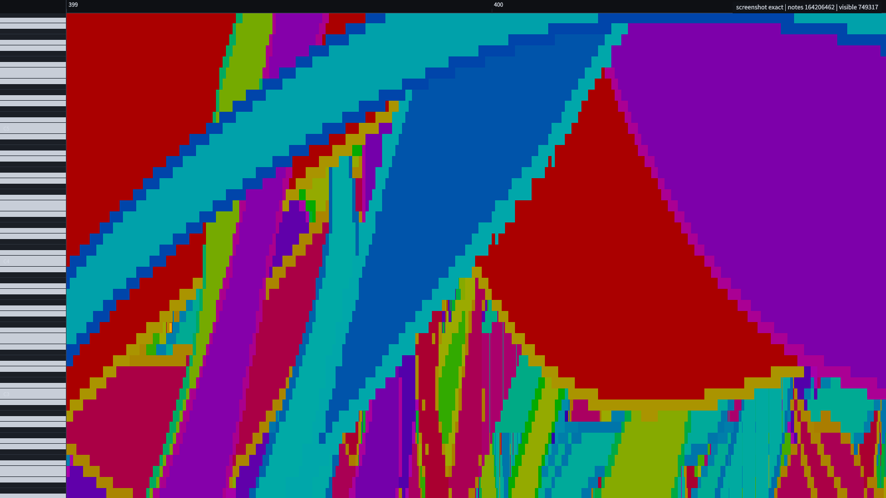
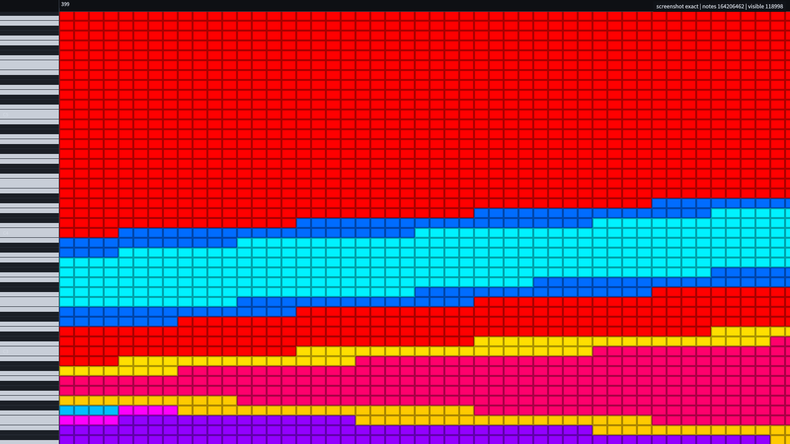
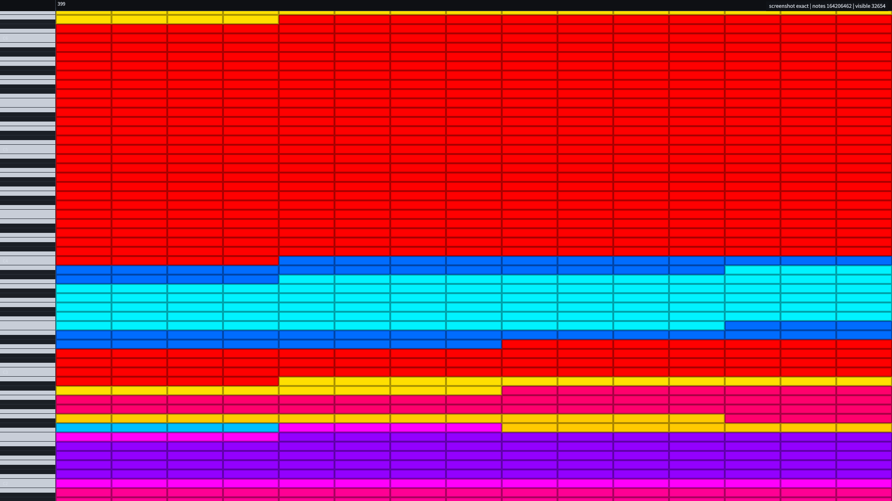
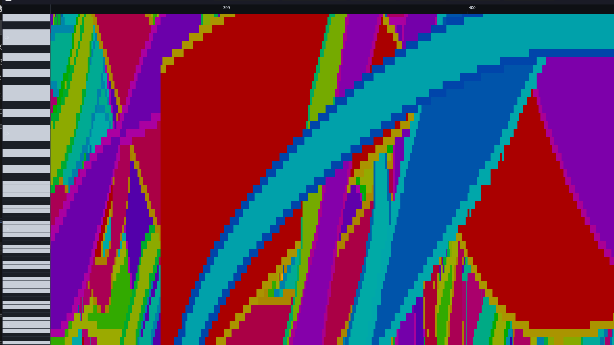

# CPU ONIONSKIN

纯 CPU 的 1.64 亿音符黑乐谱卷帘示例：winit + softbuffer 窗口，tokio 6 线程
并行光栅化，AVX2 SIMD，滚动期间用"像素平移 + 只重画新露出窄条"的增量帧
路径。**滚动与静止共用同一 Exact 光栅化：完整高度矩形 + 填充 + 每侧 2px
描边，不省填充、不省描边、不丢音轨。**







1080p 滚动中的窗口实拍（Exact-only，无 `ScrollWindowEx` 错位）：



## 运行

```powershell
# 1080p 滚动基准（密集小节；5 秒含 1 秒 DWM 暖机，统计 4 秒）
cargo run --release -p cpu-onionskin -- --bench 5 --width 1920 --height 1080

# 全曲总览热力图基准
cargo run --release -p cpu-onionskin -- --bench 3 --overview --width 1920 --height 1080

# 交互窗口（默认加载 熠星始芒 164M）
cargo run --release -p cpu-onionskin -- --width 1920 --height 1080

# 静止不刷新冒烟：3 秒后退出并打印 IDLE
cargo run --release -p cpu-onionskin -- --smoke 3

# 离屏检查音符矩形/风格（不打开窗口）
cargo run --release -p cpu-onionskin -- --screenshot target/frame.png --zoom 8.0 --width 1920 --height 1080
```

默认 MIDI：

`D:\熠星始芒：StarT+2023fix+v1.1\熠星始芒：StarT 164 Million v1.1fix.mid`

## 实测（i7-9750H 6c/12t，1920×1080，release）

滚动密集段（0.1 px/tick，最密小节 399 附近，暖机后 4 秒）：

```text
run A: frames=527 wall=131.8fps
       draw p50=2.34 p99=3.16 | present p50=3.59 p99=6.29
       work p50=5.99 p95=7.54 p99=8.41 max=9.19 ms
run B: frames=514 wall=128.5fps
       draw p50=2.38 p99=3.10 | present p50=3.76 p99=5.75
       work p50=6.23 p95=7.45 p99=8.10 max=10.79 ms
cpu=15~17% of 6 cores
=> PASS（≥60fps；p99 与 max 均 ≤16.67ms）
```

全曲总览（密度热力图，1080p）：

```text
wall=112.4fps  draw p99=6.00ms  present p99=7.66ms
work p99=14.64ms  max=16.07ms
=> PASS（≥60fps；frame p all 也在 16.67ms 内）
```

总览先按半分辨率渲染密度块，再最近邻放大；键盘/标尺只在相机变化时重画。

内存：文档 1879 MiB（`NoteEvent=12B`，与项目内加载路径完全一致）+ 密度金字塔
23.4 MiB + 派生索引约 1 MiB，无渲染音符副本。

## 快速大范围缩放基准（Paprika 310M）

```powershell
cargo run --release -p cpu-onionskin -- --midi "D:\BM-DATA\MIDI File\Paprika's Aua Ah Community Merge (FULL).mid" `
  --bench 5 --bench-zoom --width 1920 --height 1080 --workers 12 --bands 24
```

缩放锚点 = 最密小节中心，在对数空间从全曲适配缩放扫到 8 px/tick 再回来
（2 个来回）。每帧 `zoom_x` 都在变，因此不会命中滚动增量路径，只会走
Overview/Exact 全量帧，专门测最坏路径。

实测（i7-9750H 6c/12t，1920×1080，release，多次运行）：

```text
wall=18.6fps | draw p50=11.42 p99=1414.16
present p50=1.53 p99=2.37 | work p50=12.97 p99=1415.74
rss=4.31 GB
=> 严格 30 小节规则下 Paprika 高缩放 FAIL（性能另开任务处理）
```

> LOD 已统一为**同屏可见小节数 ≥30 才切总览**：1/16 音符宽度、短音符
> 百分位、键行高度等间接阈值全部移除，原始音符在高缩放（<30 小节）必须
> 显示。Paprika 这类单小节 1.4 亿音符的极端谱面在 <30 小节时 Exact 会
> 掉到 18.6fps、p99≈1.4s；性能优化另开任务，本任务只保证显示判定正确。

严格 30 小节规则下 Paprika 的 Exact 帧无法守住 100fps；workers/bands
调优不能改变「上亿音符必须逐音符扫描」这一事实，性能优化另开任务。

200fps 目标未达到：Overview 的 CPU 绘制 p50≈4.3ms + present≈1.8ms 已经
6.1ms，Exact 高倍段仍约 12ms；继续压缩需要重做 Exact 的按 key 分桶光栅，
或降低 Overview 分辨率（会损失可读性，未采用）。

## 关键设计

### 1. 同一份数据

`load_parsed_midi()` 返回的 `Arc<MidiDocument>` 同时是渲染层和编辑层的唯一
权威源。渲染 task 直接持有 `Arc` 引用，用 `ChunkedList::window_range` /
`iter_window` 惰性遍历；不构建 `Vec<NoteInstance>`。编辑用 `Arc::make_mut`
（块级 COW）修改，历史快照只持旧 `Arc`。

### 2. 无质量损失的滚动

用户要求滚动期间不得损失质量、不得改变外观，所以本示例**没有 Motion 档位**：

- 滚动与静止都走 Exact：完整高度矩形 + 填充 + 每侧 2px 描边 + owner 稳定深度；
- 所有洋葱皮轨都画，没有 `track_stride` 丢轨；
- 唯一的 LOD 是全曲 Overview 密度热力图，触发条件与 `lumino-cpu-onion`
  生产实现一致：**同屏可见小节数 ≥30 才启用**；少于 30 个小节一律 Exact，
  不再按 1/16 音符宽度、短音符百分位、键行高度或音符数量判定；
- 细音符（宽度不足 4px）按生产 UI 规则只显示描边色，这是几何约束，与静止帧一致。

### 3. 滚动增量帧（性能关键）

单纯每帧重画 1920×1080 的全量音符只有约 25fps。现在：

1. 首帧/缩放/纵向滚动/编辑后用 tokio 多 band 全量 Exact 渲染；
2. 水平滚动时把已有 CPU 帧按整数像素 `copy_within` 平移；
3. 只对新露出的窄条（约 2~20px）跑一次 band 渲染并合成；
4. 窄条用**帧的实际滚动**（`last_scroll_x += dx_int`）渲染，而不是
   `camera.scroll_x`。相机滚动的亚像素残差不会累积到复用区，窄条和主区域
   始终按整数像素对齐；
5. 呈现不再依赖 `ScrollWindowEx`：每帧把 CPU 帧复制进 DIB，用
   `present_with_damage` 完整覆盖画布 + 标尺。窗口主区域每次都来自当前
   CPU 帧，不会出现"只有窄条更新、主区域仍是旧帧"的错位；
6. 单帧水平位移上限为画布的 35%：End/Home、快速甩动等大跨度也拆成连续
   窄条 Exact 帧，相机在后续帧继续追目标，避免一帧全量 Exact 的 30ms+ 尖峰。

窄条与铺底帧都走 Exact，滚动中的音符矩形、填充、颜色、描边、洋葱皮轨
与静止帧完全一致。

### 3.1 滚动错位修复记录

旧实现用 `ScrollWindowEx` 平移窗口表面，再用 damage blit 只贴窄条。DWM 下
窗口表面的平移没有可靠提交：主区域仍是旧帧/旧滚动，只有新窄条被覆盖，
所以滚动时"当前区域"看着正常，新进入视口的音符全是错位/坏的。

修复：

- 去掉 `ScrollWindowEx`，滚动帧完整覆盖画布 + 标尺；
- 修复相机小数滚动与帧整数平移的累计误差（见上第 4 条）；
- 基准前加 1 秒暖机，排除 DWM 冷启动尖峰；
- 新增 `app/scroll_tests`：逐像素比较"平移 + 窄条"与同滚动位置的全量渲染，
  覆盖整数步长、7.4px 小数步长、长音符和洋葱皮轨。

### 3.2 填充消失修复记录

旧实现有 `Motion` 滚动档位：宽音符只画 2px 轮廓、`track_stride` 还会丢
洋葱皮轨。快速滚动/大跨度回退到 Motion 时，音符看起来"填充消失、只剩边框"，
且和静止帧外观不一致。

修复：

- 删除 `LodMode::Motion` 与所有 motion 光栅化分支；
- 删除 `track_stride` 和 `choose_track_stride`，所有音轨都画；
- `choose_mode` 只返回 Exact 或全曲 Overview；
- 新增 `exact_render_keeps_fill_and_border` 回归测试，直接断言宽音符中心
  像素是填充色、边缘像素是描边色。

### 4. tokio / SIMD

- tokio multi-thread runtime，6 个 worker，窗口按 x 切成 6 个 band；
- AVX2 运行时检测，负责整行 fill / owner 掩码 fill；无 AVX2 自动回退标量；
- `--no-simd` 可强制标量路径，便于对比/测试。

### 5. 编辑

当前轨编辑，渲染和编辑共享同一 `Arc<MidiDocument>`：

- 左键点击选择；Ctrl 切换，Shift 追加；
- 左键拖空白：框选（上限 20 万，避免 BTreeSet 过大）；
- 左键拖选中音符：ghost 预览，释放后批量移动；
- `Tab` / `I`：插入工具，左键按 snap 插入；
- 右键音符 / `Delete`：删除；
- `Ctrl+C` / `Ctrl+V`：内部剪贴板复制/粘贴；
- `Ctrl+A`：全选当前轨；
- `Ctrl+Z` / `Ctrl+Y` / `Ctrl+Shift+Z`：撤销/重做；
- 拖动预览不重扫 1.6 亿音符：先缓存起始帧，鼠标移动只恢复该帧 + 画 ghost。

撤销/重做恢复文档与派生索引的 Arc 快照，密度金字塔同步重建（约 200ms）。

## 模块

```text
src/
  main.rs            CLI、加载、索引/密度构建、截图
  app.rs             App 状态/配置
  app/window.rs      窗口、相机、Exact/Overview 选择
  app/frame.rs       全量帧/增量帧/统计
  app/events.rs      鼠标/键盘/编辑
  app/handler.rs     winit ApplicationHandler
  app/present_bridge.rs  呈现 + HUD
  present.rs         softbuffer damage present（完整画布 + 标尺）
  app/scroll_tests.rs 滚动合成逐像素回归测试
  edit.rs            编辑核心（插入/删除/复制粘贴/历史）
  edit/selection.rs  命中/框选/多选
  edit/drag.rs       移动/框选提交
  edit_overlay.rs    选择高亮/ghost/框
  render/            band、notes、SIMD、颜色、密度、chrome
  camera.rs          视口/缩放/滚动
  model.rs           派生索引（max_len/measure_counts/long_notes）
```

## 验证

```powershell
cargo test -p cpu-onionskin
cargo clippy -p cpu-onionskin --all-targets
cargo fmt -p cpu-onionskin -- --check
```

测试覆盖：相机往返、颜色与生产 shader/UI 常量一致性、SIMD 与标量一致、
密度层选择、编辑插入/删除/撤销/重做/移动/命中/框选，**滚动合成与全量
渲染逐像素一致**（整数/小数步长、长音符、洋葱皮轨、400px 大跨度窄条），
以及**宽音符中心必须是填充色、边缘必须是描边色**。

## 已知边界

- 滚动帧每帧从 DIB 完整覆盖画布 + 标尺（1080p 约 200 万像素），
  present p50≈3.6~3.8ms；这是为了正确性放弃 `ScrollWindowEx` 的代价。
  密集段仍稳定 128.5/131.8fps，p99 8.10/8.41ms，max 9.19/10.79ms。
- 水平大跨度已分帧到窄条 Exact；缩放/纵向滚动/编辑回退的全量 Exact 不在
  连续滚动统计内，但仍保持填充+描边+全部音轨，不降质量。
- 总览热力图先按 0.5× 分辨率写密度块再最近邻放大；1080p 平均 112.4fps，
  work p99 14.64ms，max 16.07ms。
- 基准前 1 秒暖机用于排除 DWM 冷启动；`--bench 5` 实际统计 4 秒。
- 拖动 ghost 为"原音符 + 新位置预览"叠加；不隐藏原音符。
- 单次框选上限 20 万音符；更大范围请缩小框选。
